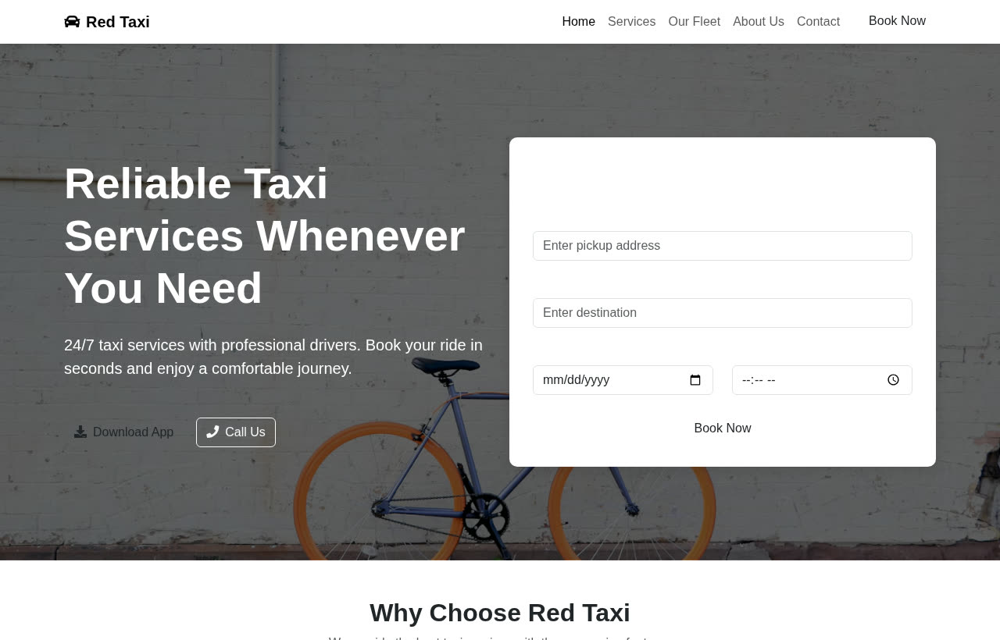

<div align="center">

# Red Taxi — React Cab Booking Website

**A responsive single-page site for a taxi company — booking UI, a live service-area map, fares, reviews, and a working contact form.**

<br />

[](https://karthik1210100.github.io/taxi_app/)
&nbsp;
[](https://github.com/karthik1210100/taxi_app/actions/workflows/ci.yml)
&nbsp;
[](https://react.dev)
&nbsp;
[](LICENSE)

[Features](#features) &middot; [Built with](#built-with) &middot; [Getting started](#getting-started) &middot; [Structure](#project-structure)

<br />

<a href="https://karthik1210100.github.io/taxi_app/"></a>

</div>

---

## What it is

A front-end website for a fictional cab company, "Red Taxi". It's a component-driven React single-page site that puts a booking form, a live map of the service area, fares, and contact details on one scrolling page.

It's a portfolio project focused on the front end: clean React component structure, a third-party map integration, and a responsive Bootstrap layout. There's no backend — the booking and contact forms are client-side only.

## Features

- **Booking panel** — a hero section with a pickup / drop / date / time form (front-end UI).
- **Service-area map** — a live, pannable map built with [React-Leaflet](https://react-leaflet.js.org/) and OpenStreetMap tiles, centred on Coimbatore with a custom taxi marker.
- **Why-choose grid** — availability, response time, pricing, and support, as Bootstrap cards with Font Awesome icons.
- **Fares, reviews, and a download CTA** — the sections a real service site would carry.
- **Working contact form** — controlled React inputs with a submit confirmation state (front-end only; nothing is sent to a server).
- **Responsive** — Bootstrap 5 grid, mobile through desktop.
- **CI** — every push builds the app on GitHub Actions.

## Built with

| Area | Tech |
|---|---|
| UI | React 19 (Create React App) |
| Styling | Bootstrap 5, custom CSS, Font Awesome |
| Map | React-Leaflet + Leaflet, OpenStreetMap tiles |
| Tooling | react-scripts, GitHub Actions, GitHub Pages |

## Getting started

```bash
npm install          # first time (use --legacy-peer-deps on newer Node)
npm start            # dev server at http://localhost:3000
npm run build        # production build into ./build
```

## Project structure

```
src/
├── App.js                 # composes the page from section components
├── Components/
│   ├── Booking/           # hero + booking form
│   ├── Service/           # why-choose grid + Leaflet service map
│   ├── Fare/              # fare cards
│   ├── Review/            # customer reviews
│   ├── Download/          # app download CTA
│   ├── Contact/           # contact details + form
│   └── About/             # about section
└── taxi-icon.png          # custom map marker
```

## Notes

This is a front-end demo. The booking and contact forms don't talk to a server — they show the UI and interaction, not a live backend. The map is real and interactive.

---

<div align="center">

Built by [Karthikeyan Subramanian](https://github.com/karthik1210100) · [Portfolio](https://karthik1210100.github.io/portfolio_2026/) · [LinkedIn](https://www.linkedin.com/in/karthik-webdev/)

</div>
